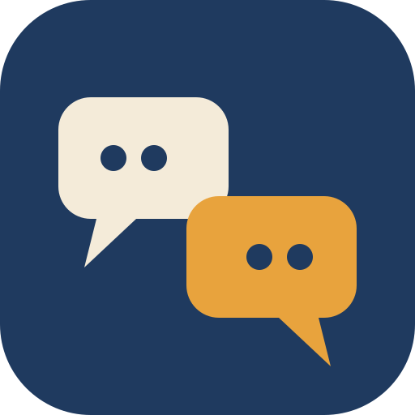

# Agent Relay



Agent Relay is an independent plugin by SwackTech LLC for Claude Code, Codex, Antigravity, opencode and pi. It teaches each agent how to find the others' live sessions and talk to them, desktop app or terminal, on the same computer or on another computer you reach with `ssh`. It is not endorsed by Anthropic, OpenAI, Google or the opencode and pi projects.

Install in Claude Code with `/plugin install agent-relay --marketplace swack-tools/agent-relay-ai-plugin`, in Codex with `codex plugin marketplace add swack-tools/agent-relay-ai-plugin` followed by `codex plugin add agent-relay@agent-relay`, in Antigravity with `agy plugin install https://github.com/swack-tools/agent-relay-ai-plugin`, in pi with `pi install git:github.com/swack-tools/agent-relay-ai-plugin`, or in opencode with `opencode plugin add 'github:swack-tools/agent-relay-ai-plugin#main::path:plugins/agent-relay'`. Restart open sessions afterwards so the hooks register them. The [repository README](https://github.com/swack-tools/agent-relay-ai-plugin#install) has the details for each.

Ask things like:

- `What agent sessions are open on laptop?`
- `Send the billing Codex session on laptop the prompt in /tmp/webapp-review.md.`
- `Ask my Claude session in billing-api on pc whether its tests pass, and wait for the answer.`

## How messages travel

| From → to | Route | When it arrives |
| --- | --- | --- |
| anything → Codex | `codex queue` into the shared Codex app-server daemon that serves the Codex app and every CLI window on that computer | Idle thread: right away. Mid-turn: when the turn ends. Not loaded: when the session is opened, or now with `--wake`. |
| anything → Claude Code | A mailbox in `~/.agent-relay/inbox/` on the target computer, delivered by this plugin's hooks | Idle session: a background watcher wakes it within seconds (for about an hour after each turn). Otherwise with the next prompt. |
| anything → Antigravity desktop app | `agentapi send-message` through the Antigravity app's own server | Right away; an idle conversation starts a turn with it. |
| anything → Antigravity IDE or `agy` CLI | `agentapi send-message` through the conversation's own language server, if that conversation has run a relay command before; otherwise a file in Antigravity's per-conversation message store | Right away through a cached server; otherwise at the start of the conversation's next turn. |
| anything → opencode | `opencode api session.prompt` into the opencode background service, which serves every opencode window on that computer; the plugin adds each session's relay address to its instructions | Idle session: right away. Mid-turn: when the turn ends. |
| anything → pi | The same mailbox as Claude Code, delivered by this package's pi extension, which checks it every two seconds | Idle session: within seconds, as a new turn. Mid-turn: when the turn ends. |
| Claude Code → Claude Code | Claude Code's own `ListAgents` and `SendMessage` tools when the target appears there (including Remote Control sessions on other machines); the mailbox otherwise | At the receiver's next tool round. |
| another computer | The same operation run over `ssh <alias>`; the relay script is streamed to the remote `python3`, so nothing extra needs installing there to send | As above, on that computer. |

Every message carries the sender's address, so the receiver can reply with one command. Long bodies (over about 6,000 characters) are written to a file on the receiving computer and the message points to it.

## Skills

| Skill | Use it to |
| --- | --- |
| `list-sessions` | List live Codex threads, Claude Code, opencode and pi sessions, and Antigravity conversations here or on an ssh host. |
| `message-session` | Send a message, prompt or file to a session, and optionally wait for its reply. |
| `handle-relay-message` | Decide what to do with an incoming relayed message and reply. |
| `relay-setup` | Diagnose ssh, PATH, Codex daemon versions, hook trust and missing sessions. |
| `relay-map` | Open the interactive Relay Map pew-pew dashboard via MCP (or run the standalone Rust/WASM hub). |

The bundled `relay` MCP server (`scripts/relay_mcp_server.py`) serves the `ui://agent-relay/relay-map.html` MCP App alongside `relay_map`, `relay_sessions`, `relay_send`, `relay_inbox`, `relay_read_reply`, `relay_broadcast`, and `relay_transcript`.

The skills drive one standard-library Python script, `scripts/relay.py`:

```sh
relay sessions [--host pc] [--all] [--json]
relay send --to codex:<thread id|name>[@host] --message '...' [--file PATH] [--wake] [--wait-reply SECONDS]
relay send --to claude:<session id|label|folder>[@host] --message '...'
relay send --to 'antigravity:<conversation id|title>[@host]' --message '...'
relay send --to 'opencode:<session id|title|folder>[@host]' --message '...'
relay send --to pi:<session id|label|folder>[@host] --message '...'
relay read <address> [--last N] [--since MS] [--wait SECONDS]
relay inbox [--peek]        relay whoami        relay name <label>
relay doctor [--host pc]    relay gc    relay install-cli
```

## Requirements

- `python3` 3.9 or newer on every computer involved.
- Key-based `ssh` between computers (`ssh <alias> true` with no prompt), in each direction you want replies to travel.
- Codex targets: a Codex app or CLI session running there, which starts the shared daemon. Claude Code targets: this plugin installed there; sessions register when they start. Antigravity targets: Antigravity itself; the desktop app must be running for idle app conversations to be woken.
- IDE and CLI language servers publish no address, so whenever an Antigravity agent runs the relay, it caches that server's loopback address and CSRF token in `~/.agent-relay/sessions/antigravity-ls/<conversation>.json` (owner-only, never printed). A stale entry is dropped on the first failed send, which then falls back to the message store; `relay gc` drops entries whose server is gone.
- opencode targets: the opencode background service running there (any opencode window starts it). pi targets: this package installed in pi there; sessions register when they start.
- Install with `agy plugin install <path>/plugins/agent-relay` to give Antigravity agents the skills; Antigravity loads only `.antigravity-plugin/plugin.json`, the skills and the root `hooks.json`.

## Privacy and safety

Messages stay on the computers involved. The relay sends nothing to any web service; ssh and the Codex daemon are the only transports. Received messages are framed as coming from a peer agent, not from the user, and the bundled skills tell the receiver to bring risky or out-of-scope requests back to its user. A message queued into Codex runs with that thread's own permissions. See [SECURITY.md](https://github.com/swack-tools/agent-relay-ai-plugin/blob/main/SECURITY.md).
